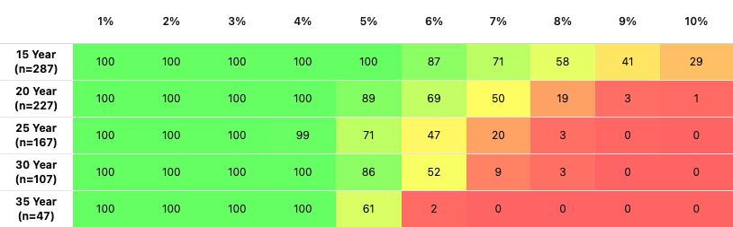

# 日本版トリニティ・スタディ

## プロジェクト概要

MSCI ACWI を日本円建てで取崩すシミュレーションを掲載するサイト「日本版トリニティスタディ」のソースコード。

毎月最新データを自動的に取得し、シミュレーション結果を更新する。

[シミュレーション結果はこちら](https://trinity-study.kanaru.jp)

## 公開 URL

[trinity-study.kanaru.jp](https://trinity-study.kanaru.jp)

## 技術スタック

- [Hono](https://hono.dev/)（SSG）
- [Cloudflare Workers](https://workers.cloudflare.com/)
- [Vite](https://vite.dev/) / [Tailwind CSS](https://tailwindcss.com/)
- [TypeScript](https://www.typescriptlang.org/)
- [GitHub Actions](https://github.com/features/actions)

## 必要要件

- Node.js v26.x

## コマンド

| コマンド            | 内容                       |
| ------------------- | -------------------------- |
| `npm run dev`       | 開発サーバーを起動         |
| `npm run build`     | ビルドと SSG               |
| `npm test`          | テスト                     |
| `npm run lint`      | lint                       |
| `npm run format`    | 整形                       |
| `npm run typecheck` | 型チェック                 |
| `npm run update`    | チャートデータを最新に更新 |

## ルーティング

`src/routes` 以下の `index.ts` / `index.tsx` がルートになります。HTTP メソッド名（`GET` など）でハンドラーを export し、`ssg = true` を export すると `npm run build` で静的 HTML に書き出します。

| ファイル                      | パス           |
| ----------------------------- | -------------- |
| `routes/index.tsx`            | `/`            |
| `routes/sitemap.xml/index.ts` | `/sitemap.xml` |

## データ

チャートデータは `src/data/chart.csv` に保存しています。GitHub Actions（`.github/workflows/update-chart.yaml`）が毎月 `npm run update` で最新データを追記し、デプロイします。

ACWI のチャートデータ : [End of day index data search](https://www.msci.com/end-of-day-data-search)

ドル円為替データ : [exchangerates API](https://exchangeratesapi.io/)

## 環境変数

- `EXCHANGE_RATE_API_KEY`: exchangerates API の認証キー（`npm run update` でのみ使用）。ローカルでは `.env` に記載します。

## デプロイ

`main` への push で `.github/workflows/deploy.yaml` が Cloudflare Workers にデプロイします。リポジトリの Secrets に `CLOUDFLARE_API_TOKEN` と `CLOUDFLARE_ACCOUNT_ID` を設定してください。
